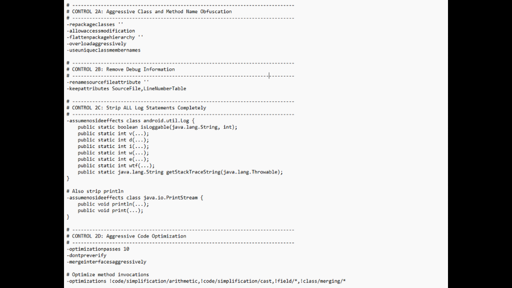

## android-platform-feature-01-risk-01-control-01

### Title

Prevent reverse engineering

### Description

Insert here

### Demonstration

#### 01. Prevent reverse engineering

Prevent reverse engineering by enabling R8/Proguard in app/build.gradle to rename classes, methods and variables into short, meaningless words

```groovy
buildTypes {
    release {
        minifyEnabled true
        proguardFiles getDefaultProguardFile('proguard-android-optimize.txt'), 'proguard-rules.pro'
        signingConfig signingConfigs.release
    }
    debug {
        signingConfig signingConfigs.release
    }
}
```



*Screenshot shows obfuscated class and method names in the application output.*

#### 02. Prevent detection of sensitive data like hardcoded secrets

Prevent detection of sensitive data like hardcoded secrets by encrypting them as XOR-encrypted byte arrays

```java
public static String getApiKey() {
    // Encrypted bytes of "sk_live_1234567890abcdef"
    byte[] encrypted = {
        0x29, 0x50, 0x17, 0x79, 0x23, 0x47, 0x05, 0x60,
        0x3B, 0x08, 0x4D, 0x21, 0x7A, 0x16, 0x58, 0x6F,
        0x3B, 0x0A, 0x4F, 0x28, 0x73, 0x1C, 0x05, 0x6D
    };
    return decrypt(encrypted);
}
```

```java
/**
 * XOR decryption - reverses the encryption
 */
private static String decrypt(byte[] encrypted) {
    byte[] decrypted = new byte[encrypted.length];
    for (int i = 0; i < encrypted.length; i++) {
        decrypted[i] = (byte) (encrypted[i] ^ KEY[i % KEY.length]);
    }
    return new String(decrypted);
}
```
