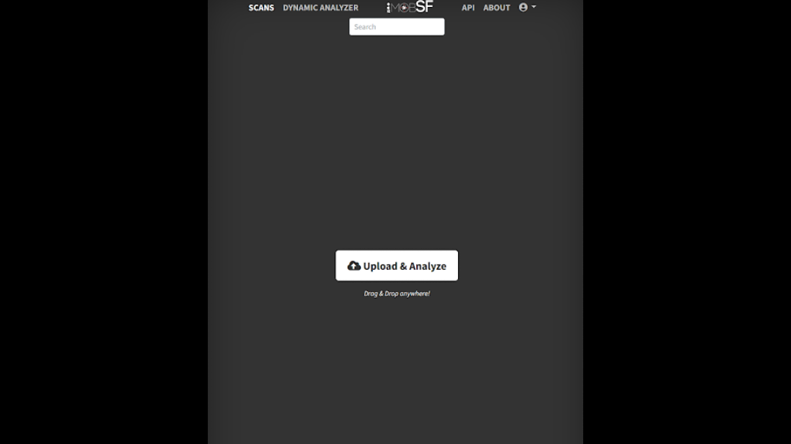
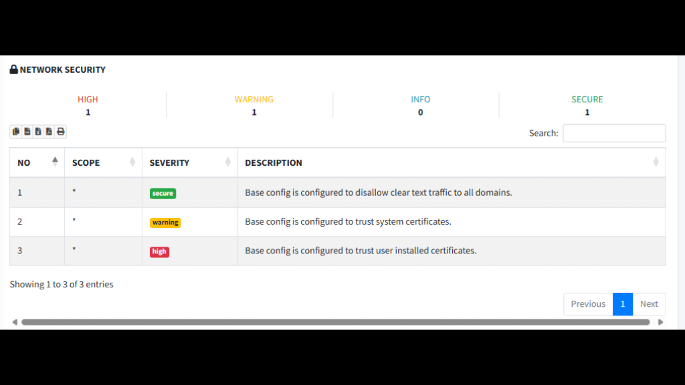

## android-platform-feature-01-risk-01

### Title

Analysing the application's APK file

### Description

Analyse the application's APK using static analysis tools to identify potential vulnerabilities in the application (MITRE ATT&CK: ***Discovery*** - TA0032).

### Demonstration

#### 01. Prepare the environment

Set up the required environment with:

* A physical Samsung A34 running Android 16 (api level 36)
* A physical Huawei P50 Pro running HarmonyOS 4.2.0 (Android API level 31)
* A MobSF instance running and accessible through a web browser

#### 02. Set up a mobile application analyser

Set up a mobile application analyser like Mobile Security Framework (MobSF) to perform analysis on APKs

#### 03. Upload a target APK

Upload a target APK to initiate the analysis

*Screenshot shows the APK upload interface in MobSF.*

*Screenshot shows findings in the MobSF network security report.*
