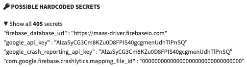

## android-platform-feature-01-risk-01

### Title

Analyse the APK

### Description

Analyse the application's APK using static analysis tools to identify sensitive plaintext information, such as hardcoded credentials, API keys, URLs, and configuration values in the application (MITRE ATT&CK: ***Discovery*** - TA0032).

### Demonstration

#### 01. Prepare the environment

Set up the required environment with:

* A physical Samsung A34 running Android 16 (api level 36)
* A physical Huawei P50 Pro running HarmonyOS 4.2.0 (Android API level 31)
* A host computer with Android Debug Bridge (ADB) installed
* A target app installed on the selected test device
* A MobSF instance running and accessible through a web browser

Connect the selected test device to the host computer with USB debugging enabled and approve the debugging prompt on the device. Confirm that it is connected:

```shell
adb devices
```

Use one connected test device at a time. If multiple devices are listed, use `adb -s <device-serial>` instead of `adb` for the commands below.

#### 02. List the device's installed application packages

List the device's installed application packages to identify the target application's package name (e.g. `sg.ndi.sp`). Replace `<package-filter>` with part of the package name, such as `sg`.

```shell
adb shell pm list packages <package-filter>
```

#### 03. Retrieve the APK paths

Retrieve the APK paths using the target application's package name to locate its installed APK files on the device.

```shell
adb shell pm path <package-name>
```

#### 04. Copy the APK

On the host computer, open a terminal in your local analysis folder and copy the APK from the device using a path returned in the previous step. Replace `<path>` with the APK path without the `package:` prefix. The APK is saved in the terminal's current directory.

```shell
adb pull <path>
```

If multiple APK paths are returned, copy each APK into the same analysis folder and retain its filename. Application content may be distributed across the base APK and split APKs.

#### 05. Analyse the APK

Upload the saved `.apk` file to MobSF and review the static analysis report for the application's overall security score, configuration issues, and sensitive plaintext information, such as hardcoded credentials, API keys, URLs, and configuration values. Record which APK was analysed; a base APK report does not cover content stored only in split APKs.



*Screenshot shows part of the findings in the MobSF hardcoded secrets report.*

Android-Platform-Feature-01-Risk-01 control measures:

- [android-platform-feature-01-risk-01-control-01](android-platform-feature-01-risk-01-control-01.md)
