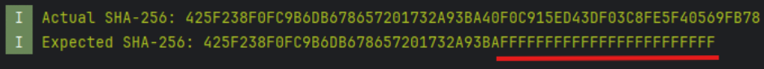
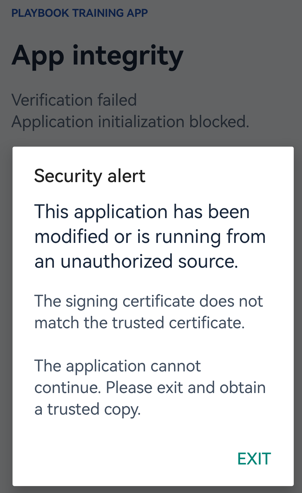
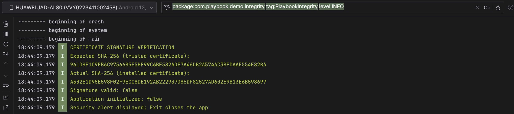

## android-platform-feature-01-risk-02-control-01

### Title

Detect modifications to your application

### Description

Detect modifications to your application by calculating the SHA-256 signature hash at runtime and comparing it to a hardcoded expected value.

### Demonstration

#### 01. Detect modifications to your application

Detect modifications to your application by calculating the SHA-256 signature hash at runtime and comparing it to a hardcoded expected value.

```java
public class MainActivity extends AppCompatActivity {

    @Override
    protected void onCreate(Bundle savedInstanceState) {
        super.onCreate(savedInstanceState);
        setContentView(R.layout.activity_main);

        // CONTROL FX02-C01: Signature verification MUST be first thing in onCreate()
        // This runs before any other initialization to prevent tampered apps from executing
        if (!SignatureVerification.verifySignature(this)) {
            // Signature mismatch detected - app has been repackaged/tampered
            SignatureVerification.showTamperDialog(this);
            // Dialog will terminate app when user clicks "Exit"
            return; // Stop further initialization
        }

        // If we reach here, signature is valid - continue normal app flow
        initializeApp();
    }

    /**
     * Normal app initialization after signature verification passes.
     */
    private void initializeApp() {
        TextView statusText = findViewById(R.id.statusText);
        statusText.setText("✓ Signature verification passed!\n\nThis app is authentic and has not been modified.");
```

*Code block shows main logic behind verifying the signature hash at runtime*

```java
private static boolean verifySignatureHash(Signature signature) {
    try {
        // Get the raw certificate bytes
        byte[] signatureBytes = signature.toByteArray();

        // Calculate SHA-256 hash
        MessageDigest digest = MessageDigest.getInstance("SHA-256");
        byte[] hashBytes = digest.digest(signatureBytes);

        // Convert hash bytes to hexadecimal string
        String actualHash = bytesToHex(hashBytes);

        // Log for debugging (remove in production or obfuscate)
        System.out.println("====================================");
        System.out.println("CERTIFICATE SIGNATURE VERIFICATION");
        System.out.println("====================================");
        System.out.println("Actual SHA-256: " + actualHash);
        System.out.println("Expected SHA-256: " + EXPECTED_SIGNATURE_HASH);

        // Compare with expected hash
        boolean isValid = actualHash.equalsIgnoreCase(EXPECTED_SIGNATURE_HASH);
        System.out.println("Signature Valid: " + isValid);
        System.out.println("====================================");

        return isValid;

    } catch (Exception e) {
        e.printStackTrace();
        return false;
    }
}
```

*Code block shows implementation of verifying the signature hash*



*Screenshot shows the actual and expected SHA-256 hashes in the application logs.*

> Note: If the app uses Play App Signing, Google re-signs it and the certificate on users' devices is the app signing key, not your upload key. Set `EXPECTED_SIGNATURE_HASH` to the SHA-256 certificate fingerprint of the app signing key shown on the app signing page in Play Console. Otherwise every install from Google Play is reported as tampered.

#### 02. Prevent your application from executing when modifications to your application are detected

Prevent your application from executing when modifications to your application are detected by displaying a non-cancellable dialog.



*Screenshot shows an integrity verification warning displayed by the application.*



*Screenshot shows different actual and expected SHA-256 hashes, failed signature verification, and blocked application initialization in Android Studio Logcat.*
