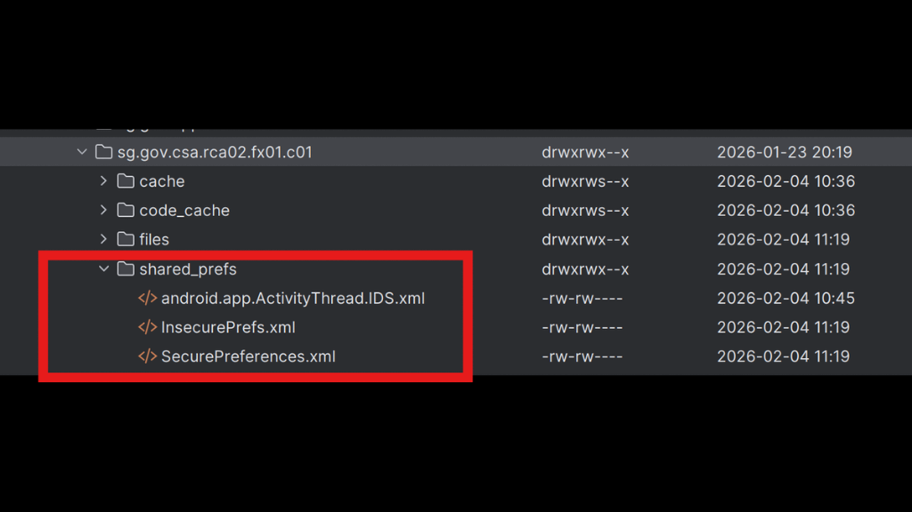
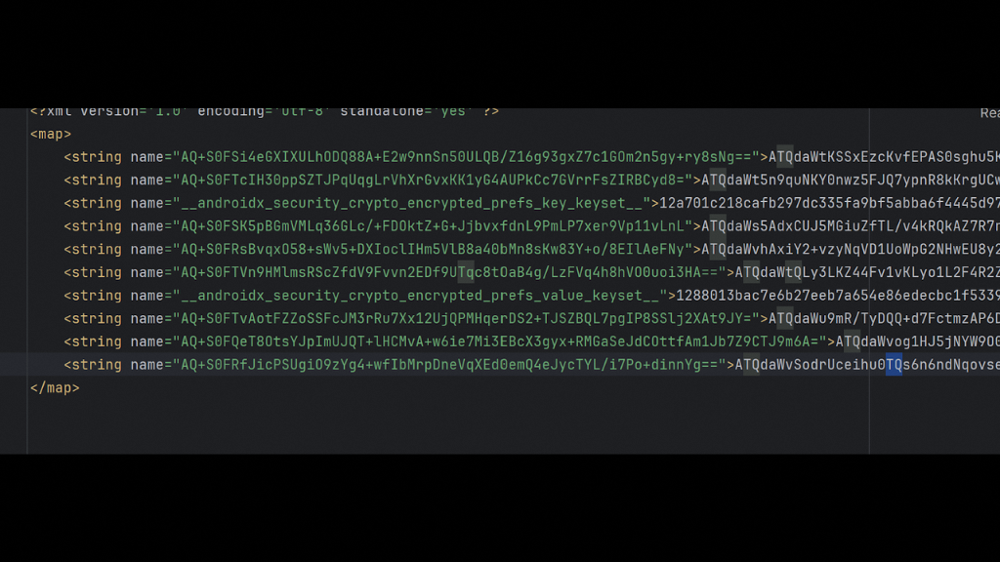

## android-platform-feature-02-risk-01-control-01

### Title

Prevent access to private data directory information

### Description

Insert here

### Demonstration

#### 01. Prevent access to private data directory information

Prevent access to private data directory information by encrypting sensitive data at rest using AES-256 encryption with a SecretKey stored in the Android Keystore

*Code excerpt from the screenshot (partial):*

```java
public String encrypt(String plaintext) throws Exception {
    if (plaintext == null || plaintext.isEmpty()) {
        return "";
    }

    Cipher cipher = Cipher.getInstance(TRANSFORMATION);
    cipher.init(Cipher.ENCRYPT_MODE, getSecretKey());

    // Encrypt the data
    byte[] encryptedBytes = cipher.doFinal(plaintext.getBytes(StandardCharsets.UTF_8));

    // Get the IV (Initialization Vector)
    byte[] iv = cipher.getIV();

    // Combine IV and encrypted data
    // Format: Base64(IV) + SEPARATOR + Base64(Ciphertext)
    String ivString = Base64.encodeToString(iv, Base64.DEFAULT);
    String encryptedString = Base64.encodeToString(encryptedBytes, Base64.DEFAULT);
```

```java
private SecretKey getSecretKey() throws Exception {
    KeyStore keyStore = KeyStore.getInstance(ANDROID_KEYSTORE);
    keyStore.load(null);
    return (SecretKey) keyStore.getKey(KEY_ALIAS, null);
}
```



*Screenshot shows the application's stored files in Device Explorer.*



*Screenshot shows encrypted data in the stored preferences file.*
