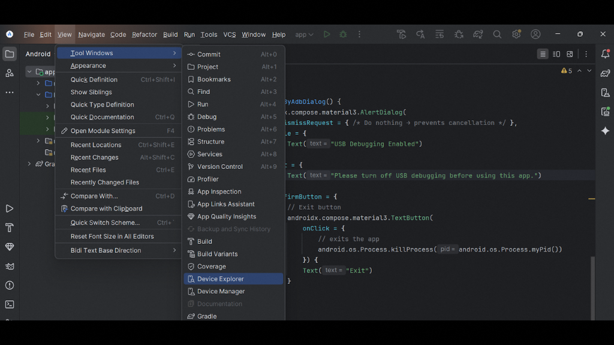
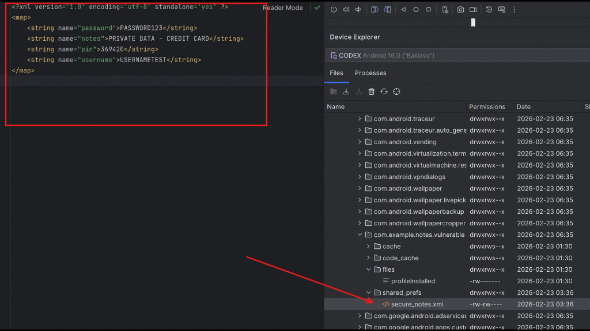

## android-platform-feature-02-risk-01

### Title

Accessing the application’s private data directory

### Description

Because the Android platform provides USB debugging feature, your application is at risk of an attacker accessing the application’s private data directory.

### Goal

As a result, this could lead to **_Credential access_** - attackers stealing usernames & passwords.

### Demonstration

#### 01. Prepare the environment

Set up the required environment with:

* A physical Samsung A34 running Android 16 (api level 36)
* A Windows host computer with Android Studio, Apktool & keytool installed

#### 02. Disassemble your APK

Disassemble your APK using APKTool to obtain the AndroidManifest.xml file

```cmd
apktool d <apk-name>
```

#### 03. Modify the AndroidManifest.xml

Modify the AndroidManifest.xml by adding debuggable="true" to enable application debugging

#### 04. Repackage your APK

Repackage your APK using APKTool to recompile it

```cmd
apktool b --debug <directory>
```

#### 05. Sign your APK or APKs

Sign your APK or APKs with a self-signed certificate using the keytool command to allow installation on an Android device, as all apps must be signed

```cmd
keytool -alias colesmith -genkey -v -keystore release.keystore -keyalg RSA
```
```cmd
apksigner sign --ks release.keystore base.apk
```

#### 06. Install your repackaged APK

Install your repackaged APK to verify if it is debuggable

```cmd
adb install <apk> or adb install-multiple <apk1> <apk2>
```

#### 07. Open Android Studio

Open Android Studio and go to View → Tool Windows → Device File Explorer to view device files



*Screenshot shows the Device Explorer option in Android Studio.*

#### 08. Access your application’s private data directory

Navigate to /data/data/package_name/ to access your application’s private data directory. Note: The package name will vary between applications



*Screenshot shows application files and their contents in Android Studio's Device Explorer.*
