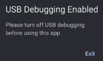

## android-platform-feature-02-risk-02-control-01

### Title

Detect USB debugging

### Description

Detect USB debugging by reading Settings.Global.ADB_ENABLED during the onCreate() and onResume() methods.

### Demonstration

#### 01. Detect USB debugging

Detect USB debugging by reading `Settings.Global.ADB_ENABLED` during the `onCreate()` and `onResume()` methods.

```kotlin
private fun isAdbEnabled(): Boolean {
    return try {
        android.provider.Settings.Global.getInt(
            contentResolver,
            android.provider.Settings.Global.ADB_ENABLED
        ) == 1
    } catch (e: Exception) {
```

*Code block shows implementation of reading `Settings.Global.ADB_ENABLED`*

#### 02. Prevent your application from executing when USB Debugging is detected

Prevent your application from executing when USB Debugging is detected by displaying a non-cancellable alert with a button that forces the user to terminate the application.

```kotlin
@Composable
fun BlockedByAdbDialog() {
    androidx.compose.material3.AlertDialog(
        onDismissRequest = { /* Do nothing → prevents cancellation */ },
        title = {
            Text("USB Debugging Enabled")
        },
        text = {
            Text("Please turn off USB debugging before using this app.")
        },
        confirmButton = {
            // Exit button
            androidx.compose.material3.TextButton(
                onClick = {
                    // exits the app
                    android.os.Process.killProcess(android.os.Process.myPid())
                }) {
                Text("Exit")
            }
```

*Code block shows implementation of alerting the user that USB debugging is enabled*



*Screenshot shows the USB debugging warning displayed on the device.*

The source code with the implemented control can be found [here](control-examples/android-platform-feature-02-risk-02-control-01.zip).
