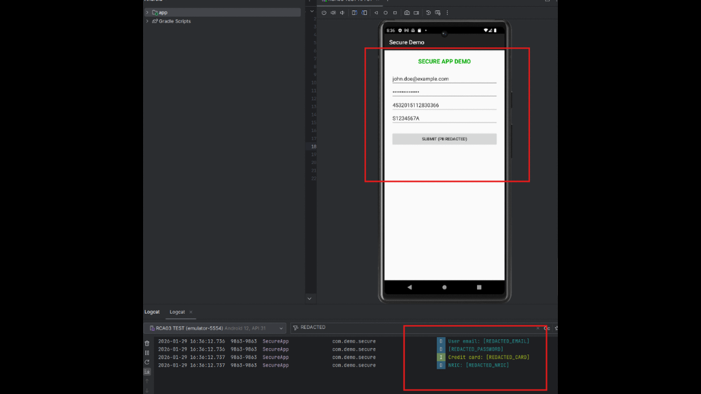

## android-platform-feature-02-risk-02-control-02

### Title

Detect sensitive data patterns in log messages

### Description

Detect sensitive data patterns in log messages by using regular expressions to identify potential leaks before they reach Logcat

### Demonstration

#### 01. Detect sensitive data patterns in log messages

Detect sensitive data patterns in log messages by using regular expressions to identify potential leaks before they reach Logcat

```java
private static final String[][] PII_PATTERNS = {
    {"[a-zA-Z0-9._%+-]+@[a-zA-Z0-9.-]+\\.[a-zA-Z]{2,}", "[REDACTED_EMAIL]"},
    {"\\b\\d{4}[- ]?\\d{4}[- ]?\\d{4}[- ]?\\d{4}\\b", "[REDACTED_CARD]"},
    {"[STFGM]\\d{7}[A-Z]", "[REDACTED_NRIC]"},
    {"(?i)(password|pwd|pass)[=:\"'\\s]+[^\\s,\"']+", "[REDACTED_PASSWORD]"}
};

private static String sanitize(String message) {
    if (message == null) return "[null]";
    String result = message;
    for (String[] pattern : PII_PATTERNS) {
        result = result.replaceAll(pattern[0], pattern[1]);
    }
    return result;
}

public static void d(String tag, String msg) { Log.d(tag, sanitize(msg)); }
public static void i(String tag, String msg) { Log.i(tag, sanitize(msg)); }
public static void e(String tag, String msg) { Log.e(tag, sanitize(msg)); }
public static void v(String tag, String msg) { Log.v(tag, sanitize(msg)); }
public static void w(String tag, String msg) { Log.w(tag, sanitize(msg)); }
```

#### 02. Prevent sensitive data from being exposed in the logs

Prevent sensitive data from being exposed in the logs by replacing them with safe placeholders (e.g. “REDACTED_EMAIL”)

```java
@Override
protected void onCreate(Bundle savedInstanceState) {
    super.onCreate(savedInstanceState);
    setContentView(R.layout.activity_main);

    EditText emailInput = findViewById(R.id.emailInput);
    EditText passwordInput = findViewById(R.id.passwordInput);
    EditText creditCardInput = findViewById(R.id.creditCardInput);
    EditText nricInput = findViewById(R.id.nricInput);

    Button submitBtn = findViewById(R.id.submitButton);
    submitBtn.setOnClickListener(v -> {
        String email = emailInput.getText().toString();
        String password = passwordInput.getText().toString();
        String creditCard = creditCardInput.getText().toString();
        String nric = nricInput.getText().toString();

        // Same logging as VulnerableApp, but using SecureLogger
        // PII is automatically redacted before reaching Logcat
        SecureLogger.d(TAG, "User email: " + email);
        SecureLogger.d(TAG, "Password: " + password);
        SecureLogger.i(TAG, "Credit card: " + creditCard);
        SecureLogger.d(TAG, "NRIC: " + nric);

        Toast.makeText(this, "Check Logcat - PII is redacted!", Toast.LENGTH_SHORT).show();
    });
}
```



*Screenshot shows redacted log output alongside the application interface.*
