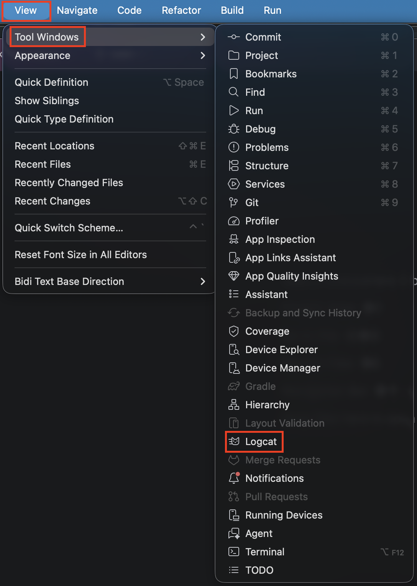
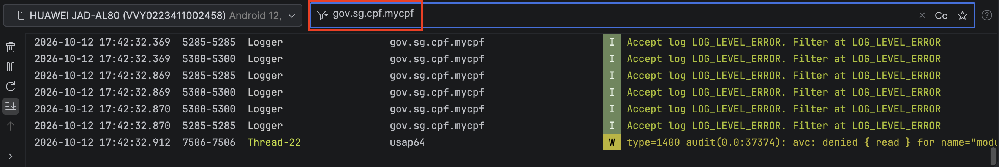
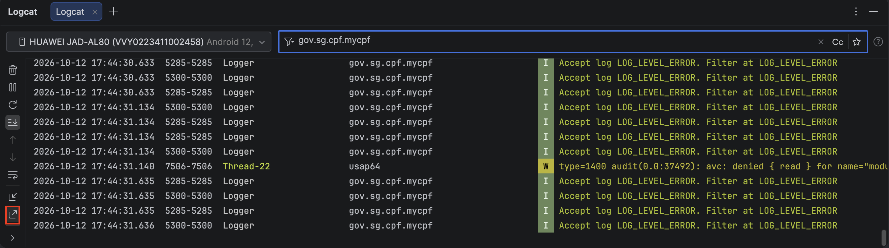
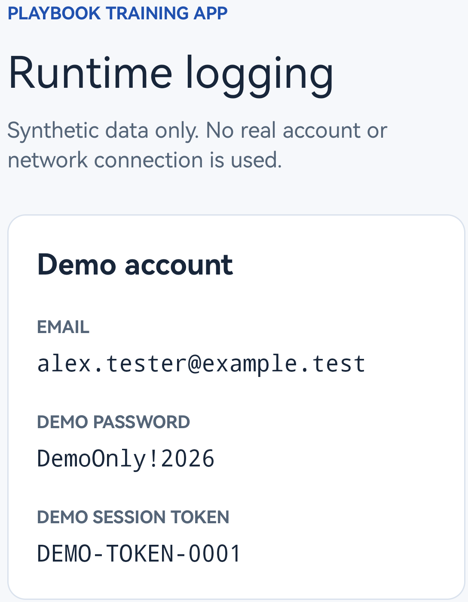
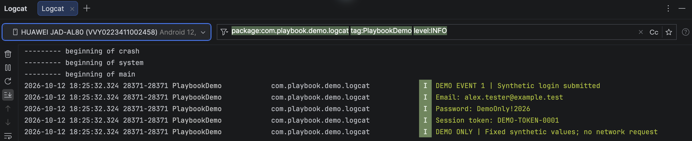

## android-platform-feature-02-risk-02

### Title

Capturing the application's runtime logs via Android Debug Bridge (ADB)

### Description

Capture the application's runtime logs via Android Debug Bridge (ADB) to gather sensitive data, such as session tokens and credit card numbers (MITRE ATT&CK: ***Collection*** - TA0035).

### Demonstration

#### 01. Prepare the environment

Set up the required environment with:

* A physical Samsung A34 running Android 16 (api level 36)
* A physical Huawei P50 Pro running HarmonyOS 4.2.0 (Android API level 31)
* A Windows host computer with Android Studio & adb installed

#### 02. Enable developer mode 

On the AVD, go to `Settings > About Device > Build Number`. Then, click on the “`Build Number`” setting 7 times to enable developer mode.

* Samsung A34: Go to `Settings > About phone > Software information` and tap `Build number` seven times.
* Huawei P50 Pro: Go to `Settings > About phone` and tap `HarmonyOS version` seven times.

*Screenshot shows the `Build number` setting highlighted on the device.*

Enter the device's lock-screen PIN if prompted. Open `Developer options` and enable `USB debugging`.

#### 03. Toggle the USB Debugging option

Toggle the USB Debugging option to enable USB Debugging.

*Screenshot shows the `USB debugging` toggle enabled in Developer options.*

#### 04. View the Logcat window

Open the Logcat window in Android Studio by navigating to `View → Tool Windows → Logcat` from the menu bar to view logs from the connected device in real-time.

*Screenshot shows the Logcat option in Android Studio.*

#### 05. Perform sensitive user actions

Perform sensitive user actions in your application (e.g.  login, profile updates, payments) to trigger logs that might expose sensitive data.

#### 06. Filter the logs

Filter the logs by your application’s package name, (e.g. "`gov.sg.cpf.mycpf`") to isolate the specific logs related to your application.

*Screenshot shows application log entries filtered by package name.*

#### 07. Export the filtered logs

Export the filtered logs using the Logcat’s export function to capture evidence of any sensitive data exposure in the logs.

*Screenshot shows icon to export filtered logs.*

*Screenshot shows sensitive information displayed on a testing app.*

*Screenshot shows the corresponding log entries in Android Studio.*

Android-Platform-Feature-02-Risk-02 control measures:

- [android-platform-feature-02-risk-02-control-01](android-platform-feature-02-risk-02-control-01.md)
- [android-platform-feature-02-risk-02-control-02](android-platform-feature-02-risk-02-control-02.md)

