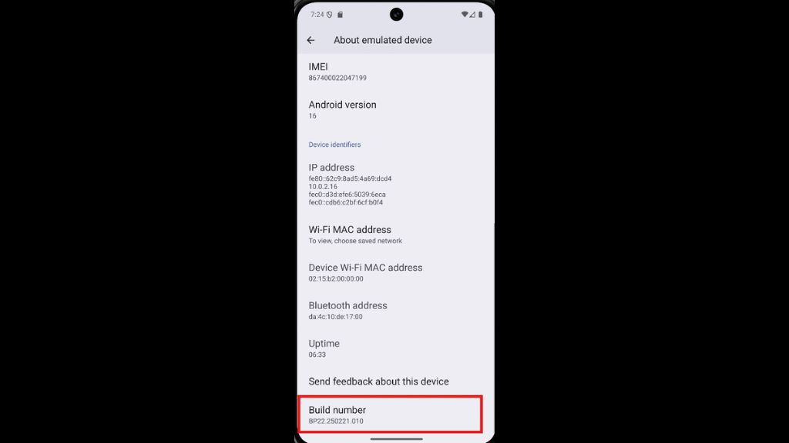
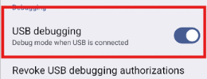

## android-platform-feature-02

### Title

USB debugging

### Description

The Android platform provides USB debugging feature.

### Additional context

USB debugging is a feature that allows communication between an Android device and a computer via Android Debug Bridge (ADB). It enables developers to install apps, run commands, access logs, and debug applications.

### Demonstration

#### 01. Prepare the environment

Set up the required environment with:

* A physical Samsung A34 running Android 16 (api level 36)
* A physical Huawei P50 Pro running HarmonyOS 4.2.0 (Android API level 31)

#### 02. Enable developer mode

On the AVD, go to “Settings > About Device > Build Number”. Then, click on the “Build Number” setting 7 times to enable developer mode

*Screenshot shows the `Build number` setting highlighted on the device.*

#### 03. Toggle the USB Debugging option

Toggle the USB Debugging option to enable USB Debugging

*Screenshot shows the `USB debugging` toggle enabled in Developer options.*

Because the Android platform provides APK acquisition feature, your app is at risk of:

- [android-platform-feature-02-risk-01](android-platform-feature-02-risk-01.md)
- [android-platform-feature-02-risk-02](android-platform-feature-02-risk-02.md)
