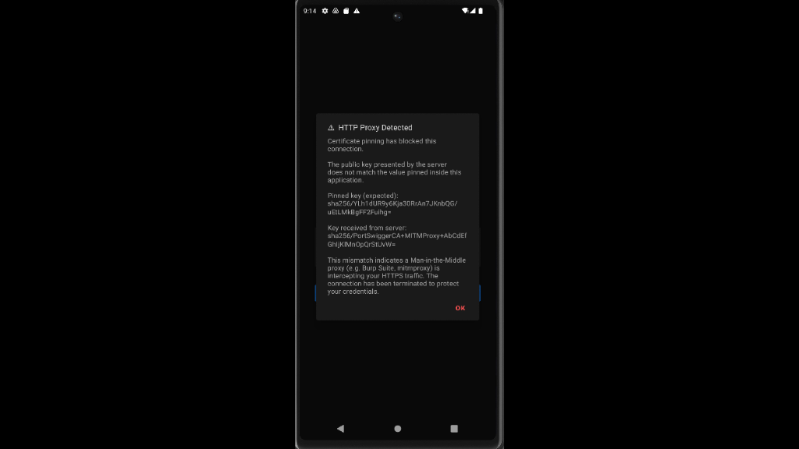

## android-platform-feature-03-risk-01-control-01

### Title

Detect a certificate mismatch via CertificatePinner

### Description

Detect a certificate mismatch via CertificatePinner by first pinning a hash in your application at build time and then comparing it to the server's actual SHA-256 public key hash to ensure your application communicates only with the legitimate server.

### Demonstration

#### 01. Detect a certificate mismatch via CertificatePinner

Detect a certificate mismatch via CertificatePinner by first pinning a hash in your application at build time and then comparing it to the server's actual SHA-256 public key hash to ensure your application communicates only with the legitimate server.

```java
private static final CertificatePinner certificatePinner = new CertificatePinner.Builder()
        .add("httpbin.org", "sha256/3Jqfn7l2xPrzr1je9Euw3X3lFPMAGLApLECocD6YNMY=")
        .add("httpbin.org", "sha256/jQJTbIh0grw0/1TkHSumWb+Fs0Ggogr621gT3PvPKG0=")
        .add("httpbin.org", "sha256/C5+lpZ7tcVwmwQIMcRtPbsQtWLABXhQzejna0wHFr8M=")
        .build();
```

#### 02. Prevent your application from sending network requests to unauthorised servers

Prevent your application from sending network requests to unauthorised servers by rejecting any connection whose server certificate hash does not match the pinned value.



*Screenshot shows the application's warning after certificate pinning rejected the certificate presented by Burp Suite.*

When verifying this control, make Burp's CA trusted as described in the note in [android-platform-feature-03-risk-01](android-platform-feature-03-risk-01.md). With only a user-installed CA, the connection fails even without pinning, so the check would pass regardless.