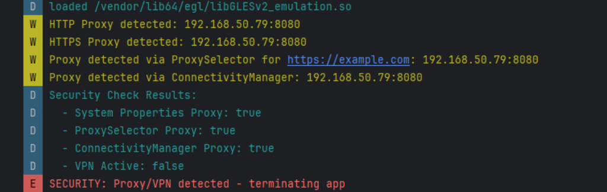

## android-platform-feature-03-risk-01-control-02

### Title

Detect an active HTTP proxy

### Description

Detect an active HTTP proxy by checking the mobile device’s network configuration using ConnectivityManager and ProxySelector during the `onCreate()` and `onResume()` methods.

### Demonstration

#### 01. Detect an active HTTP proxy

Detect an active HTTP proxy by checking the mobile device’s network configuration using ConnectivityManager and ProxySelector during the onCreate() and onResume() methods.

```java
public static boolean isProxySetViaConnectivityManager(Context context) {
    if (Build.VERSION.SDK_INT >= Build.VERSION_CODES.M) {
        try {
            ConnectivityManager cm = (ConnectivityManager)
                    context.getSystemService(Context.CONNECTIVITY_SERVICE);

            if (cm != null) {
                Network activeNetwork = cm.getActiveNetwork();
                if (activeNetwork != null) {
                    // Get proxy info for active network
                    ProxyInfo proxyInfo = cm.getDefaultProxy();
                    if (proxyInfo != null) {
                        String host = proxyInfo.getHost();
                        int port = proxyInfo.getPort();
                        if (host != null && !host.isEmpty()) {
                            Log.w(TAG, "Proxy detected via ConnectivityManager: " +
                                    host + ":" + port);
                            return true;
                        }
                    }
                }
            }
        } catch (Exception e) {
            Log.e(TAG, "Error checking ConnectivityManager: " + e.getMessage());
        }
    }
    return false;
}
```

```java
public static boolean isVpnActive(Context context) {
    if (Build.VERSION.SDK_INT >= Build.VERSION_CODES.M) {
        try {
            ConnectivityManager cm = (ConnectivityManager)
                    context.getSystemService(Context.CONNECTIVITY_SERVICE);

            if (cm != null) {
                Network activeNetwork = cm.getActiveNetwork();
                if (activeNetwork != null) {
                    NetworkCapabilities caps = cm.getNetworkCapabilities(activeNetwork);
                    if (caps != null && caps.hasTransport(NetworkCapabilities.TRANSPORT_VPN)) {
                        Log.w(TAG, "VPN connection detected");
                        return true;
                    }
                }
            }
        } catch (Exception e) {
            Log.e(TAG, "Error checking VPN: " + e.getMessage());
        }
    }
    return false;
}
```

#### 02. Prevent the application from executing when a HTTP Proxy is detected

Prevent the application from executing when a HTTP Proxy is detected by displaying a non-cancellable alert with a button that forces the user to terminate the application.



*Screenshot shows HTTP proxy detection messages in the application logs.*
