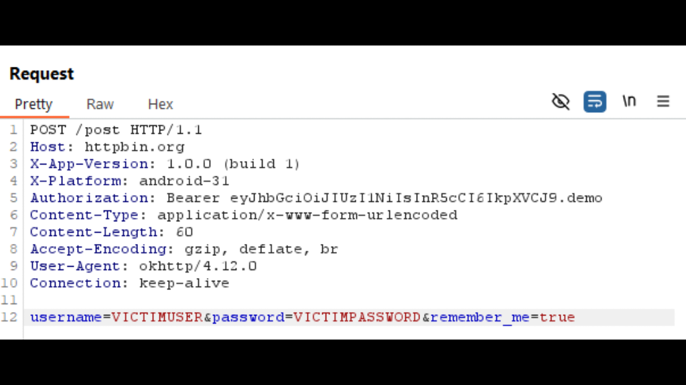

## android-platform-feature-03-risk-01

### Title

Intercepting the application's network traffic

### Description

Intercept the application's network traffic through an HTTP proxy to gather data transmitted by the application (MITRE ATT&CK: ***Collection*** - TA0035).

### Demonstration

#### 01. Prepare the environment

Set up the required environment with:

* A physical Samsung A34 running Android 16 (api level 36)
* A physical Huawei P50 Pro running HarmonyOS 4.2.0 (Android API level 31)
* A Windows host computer
* A Burp Suite instance running

#### 02. Launch your application

Launch your application and perform a sensitive user action, such as logging in or registering, to trigger API requests that may transmit sensitive data

#### 03. Inspect the intercepted requests and responses

Inspect the intercepted requests and responses in Burp Suite to identify any sensitive information

*Screenshot shows an intercepted HTTP request containing username and password fields.*
