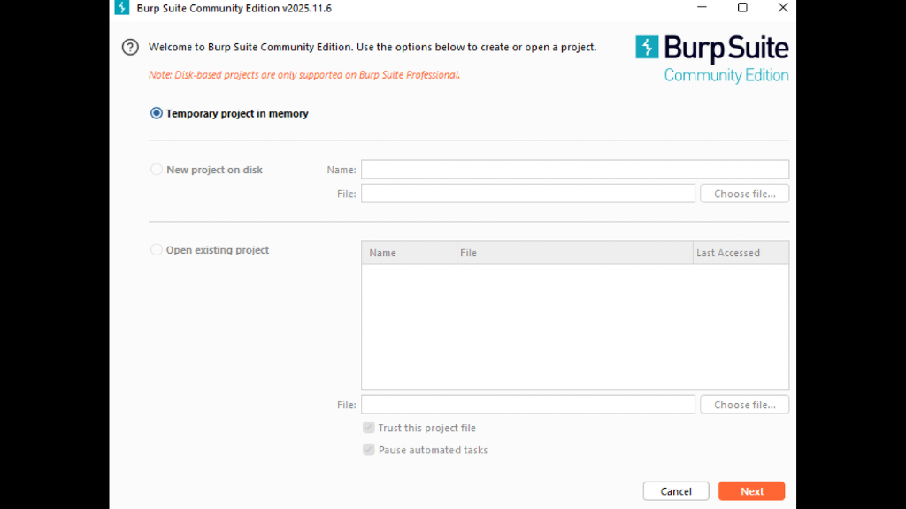
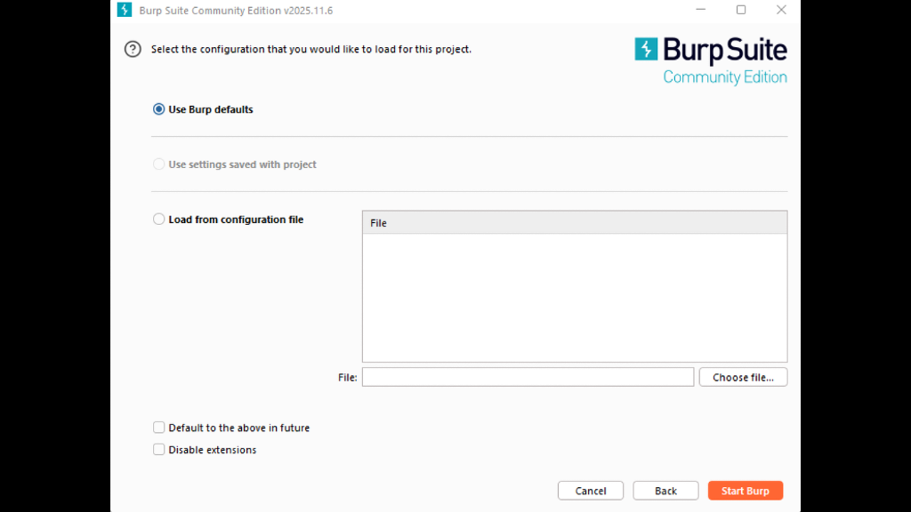
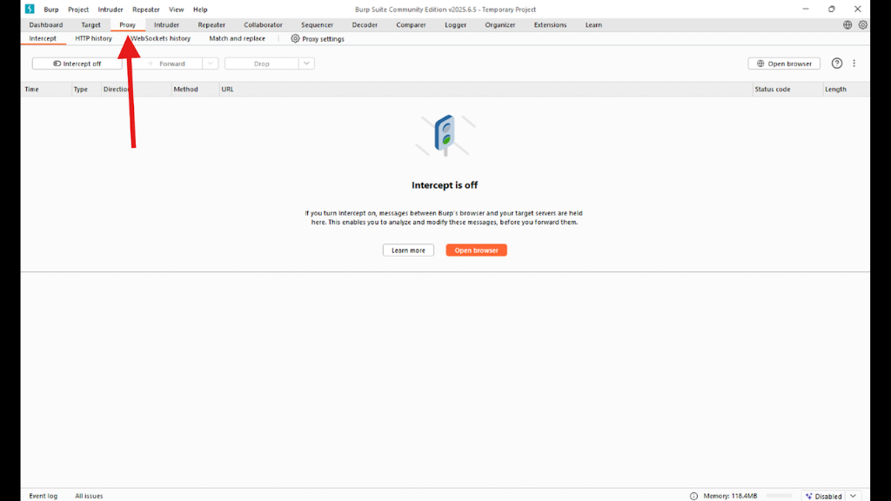
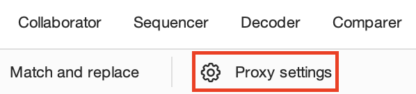
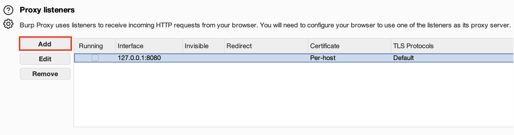
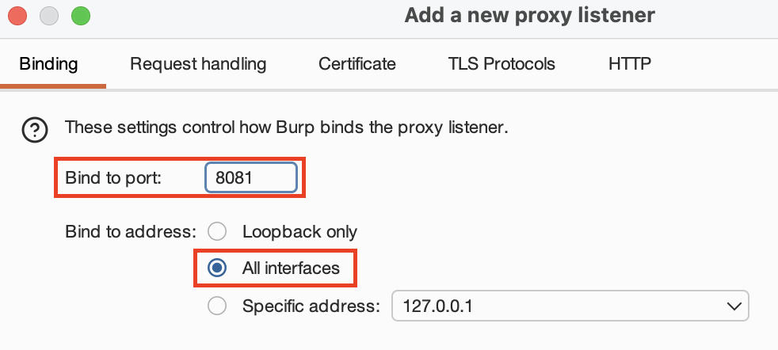
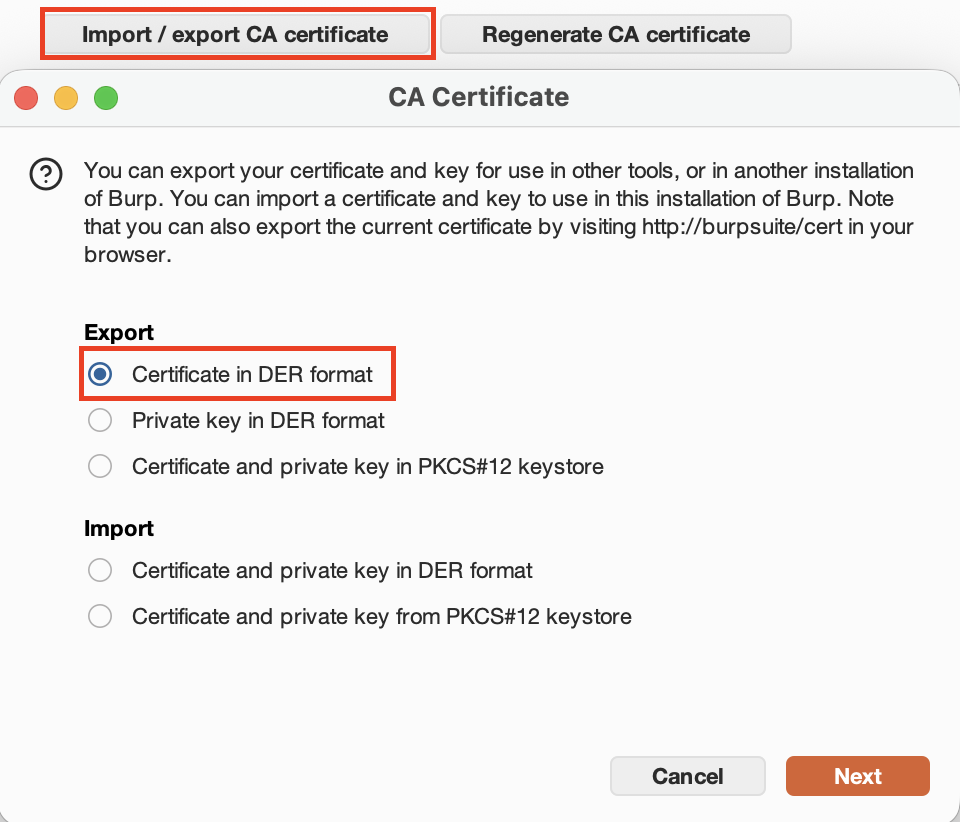
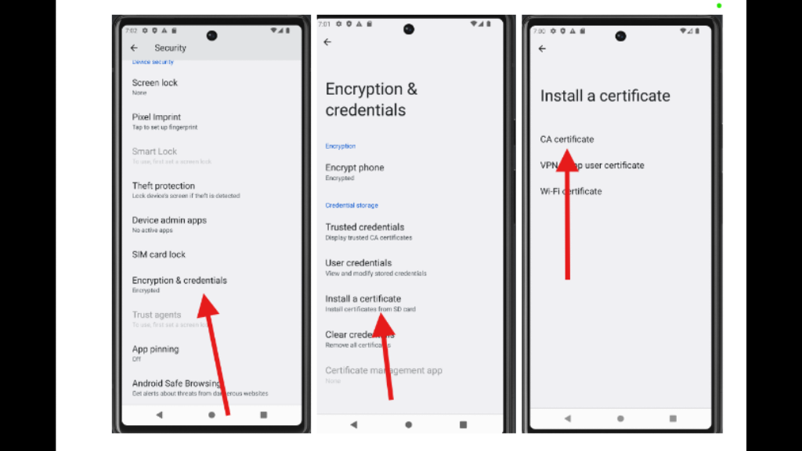

## android-platform-feature-03

### Title

HTTP Proxy

### Description

The Android platform provides HTTP Proxy feature.

### Additional context

HTTP Proxy is a feature that allows all network traffic to be routed from an Android Virtual Device through an intermediary proxy server before it reaches the internet. Proxies are usually used for corporate network access or content filtering..

### Demonstration

#### 01. Prepare the environment

Set up the required environment with:

* A physical Samsung A34 running Android 16 (api level 36)
* A physical Huawei P50 Pro running HarmonyOS 4.2.0 (Android API level 31)

#### 02. Configure Burp Suite

Configure Burp Suite to listen on all network interfaces of the host computer running Burp so the AVD can connect to it by launching Burp, clicking ‘Next’, selecting ‘Start Burp’, navigating to the ‘Proxy’ tab, opening ‘Proxy Settings’, selecting the existing listener at 127.0.0.1:8080, clicking ‘Edit’, changing the binding to ‘All Interfaces’, and clicking ‘OK’ to apply the changes



*Screenshot shows the new project setup screen in Burp Suite.*



*Screenshot shows the configuration screen before starting Burp Suite.*



*Screenshot shows the `Proxy` tab highlighted in Burp Suite.*



*Screenshot shows the `Proxy settings` button highlighted in Burp Suite.*



*Screenshot shows the proxy listener settings and edit option.*



*Screenshot shows the listener binding set to `All interfaces`.*

#### 03. Configure Android Debug Bridge (ADB)

Configure Android Debug Bridge (ADB) to set the AVD’s HTTP proxy to the host computer’s IP address and Burp port so traffic from the AVD is routed through Burp by launching the AVD, opening an ADB shell (adb shell), finding the host IP using ipconfig or ifconfig, and running settings put global http_proxy <HOST_IP>:8080

#### 04. Export Burp Suite’s CA certificate

To enable interception of HTTPS traffic: Export Burp Suite’s CA certificate in DER format to create a certificate file (ca.crt) that will be installed into the AVD’s trusted credential store



*Screenshot shows the certificate export dialog with the DER format selected.*

#### 05. Transfer the ca.crt file

To enable interception of HTTPS traffic: Transfer the ca.crt file from the host computer to the AVD using ADB so that the Android system can access and install it as a trusted CA certificate

```cmd
adb -s emulator-<id> push ca.crt /sdcard/Download/ca.crt
```

#### 06. Install the CA certificate

To enable interception of HTTPS traffic: Install the CA certificate on the Android Virtual Device by navigating to Settings → Security → Encryption & Credentials → Install a Certificate → CA Certificate and selecting the uploaded ca.crt file to allow Android system to trust Burp’s generated certificates and enable HTTPS traffic inspection



*Screenshot shows the Android settings screens for installing a CA certificate.*

Because the Android platform provides HTTP Proxy feature, your app is at risk of:

- [android-platform-feature-03-risk-01](android-platform-feature-03-risk-01.md)
