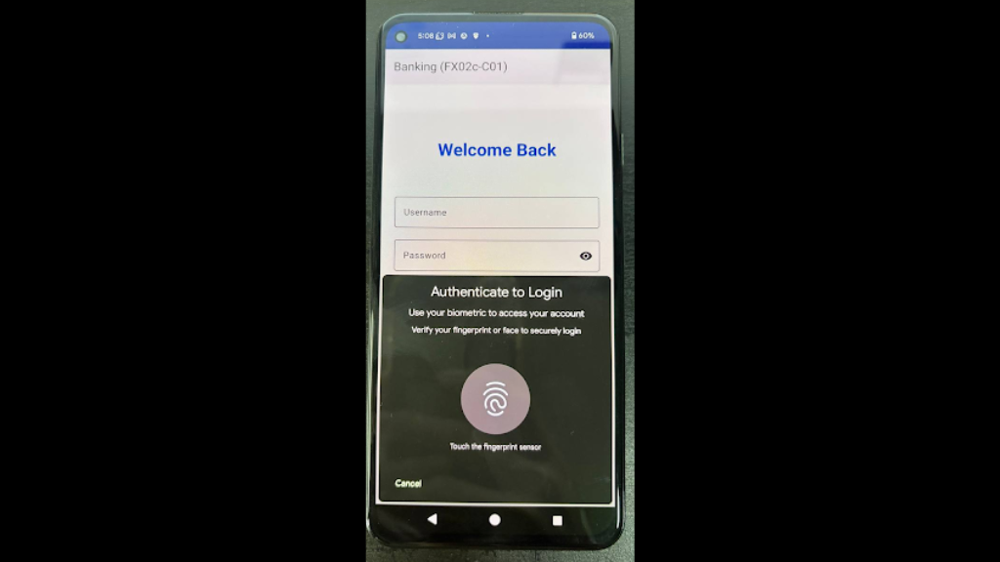

## android-platform-feature-05-risk-01-control-01

### Title

Prevent unauthorised programmatic operations like logging out

### Description

Prevent unauthorised programmatic operations like logging out by requiring user verification through biometric authentication. A logout button calls `initiateLogoutBiometricAuth()`, which triggers the biometric authentication prompt.

### Demonstration

#### 01. Prevent unauthorised programmatic operations like logging out

Prevent unauthorised programmatic operations like logging out by requiring user verification through biometric authentication. A logout button calls `initiateLogoutBiometricAuth()`, which triggers the biometric authentication prompt.

```kotlin
class DashboardActivity : AppCompatActivity() {
    /**
     * Handle logout button click
     * Initiates biometric authentication or falls back to dialog
     */
    private fun handleLogoutClick() {
        if (biometricAuthManager.isBiometricAvailable()) {
            // Device has biometric - require biometric for logout
            initiateLogoutBiometricAuth()
        } else {
            // Fallback: Show traditional confirmation dialog
            showLogoutConfirmation()
        }
    }

    /**
     * Initiate biometric authentication for logout verification
     */
    private fun initiateLogoutBiometricAuth() {
        biometricAuthManager.authenticate(
            activity = this,
            title = "Confirm Logout",
            subtitle = "Verify your identity to logout",
            description = "Use your biometric to confirm you want to logout"
        )
    }

    /**
     * Observe biometric authentication results for logout
     */
    private fun observeBiometricResults() {
        biometricAuthManager.authenticationResult.observe(this) { result ->
            when (result) {
                is BiometricAuthManager.BiometricAuthResult.Success -> {
                    Toast.makeText(
                        this,
                        "Logout confirmed",
                        Toast.LENGTH_SHORT
                    ).show()
                    performLogout()
                }

                is BiometricAuthManager.BiometricAuthResult.Failure -> {
                    Toast.makeText(
                        this,
                        "Biometric verification failed: ${result.message}",
                        Toast.LENGTH_SHORT
                    ).show()
                }

                is BiometricAuthManager.BiometricAuthResult.Error -> {
                    handleBiometricError(result.errorCode, result.errorMessage)
                }
            }
        }
    }
```

*Code block shows implementation of authentication for logout function*



*Screenshot shows the biometric authentication prompt before logout.*

> Note: On devices without enrolled biometrics, `showLogoutConfirmation()` shows an ordinary dialog, which an accessibility service can click. Use the device credential as the fallback (`BIOMETRIC_STRONG or DEVICE_CREDENTIAL` in `BiometricPrompt`) instead of a plain dialog, and test the control on a device with no biometrics enrolled.