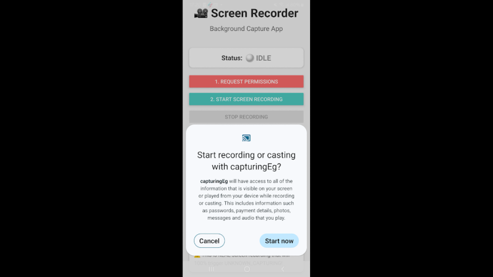
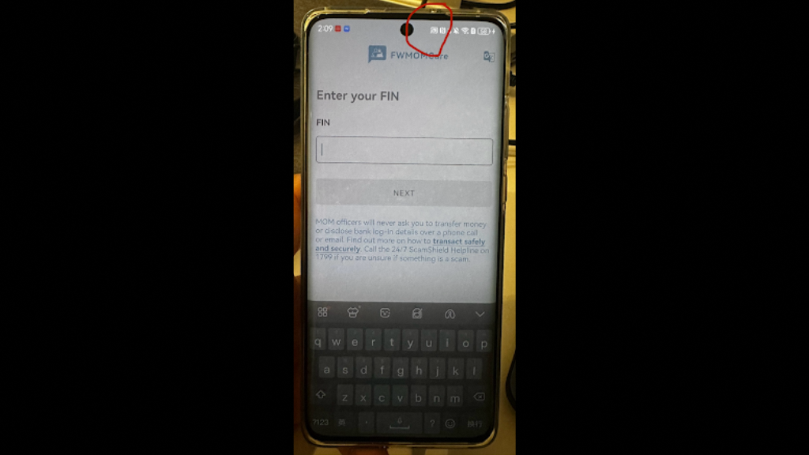
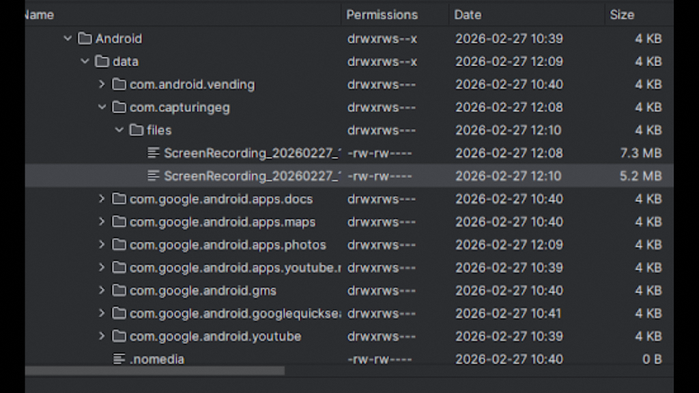

## android-platform-feature-06-risk-01

### Title

Capturing on-screen content

### Description

Because the Android platform provides screen recording feature, your application is at risk of an attacker capturing on-screen content.

### Goal

As a result, this could lead to **_Collection_** - attackers gathering data of interest to their goal.

### Demonstration

#### 01. Prepare the environment

Set up the required environment with:

* An emulated Google Pixel 6 running Android 12 (api level 31)

#### 02. Create a malicious application

Create a malicious application by declaring a foreground service in the manifest with foregroundServiceType="mediaProjection" to register the application’s screen capture capability

```xml
<!-- Foreground service for persistent capture -->
<uses-permission android:name="android.permission.FOREGROUND_SERVICE"/>
<uses-permission android:name="android.permission.FOREGROUND_SERVICE_MEDIA_PROJECTION"/>

<!-- Screen projection/capture permission -->
<uses-permission android:name="android.permission.CAPTURE_VIDEO_OUTPUT"/>
<uses-permission android:name="android.permission.CAPTURE_SECURE_VIDEO_OUTPUT"/>
```

```xml
<service
    android:name=".ScreenCaptureService"
    android:enabled="true"
    android:exported="false"
    android:foregroundServiceType="mediaProjection" />
```

#### 03. Define how the screen capture service operates

Define how the screen capture service operates by implementing a service class (e.g., .ScreenCaptureService) that requests explicit user permission for screen recording, captures the device screen, and persists the recorded output

```kotlin
@ReactMethod
fun requestScreenCapturePermission(promise: Promise) {
    val activity = reactApplicationContext.currentActivity
    if (activity == null) {
        promise.reject("NO_ACTIVITY", "Activity is null")
        return
    }

    try {
        screenCapturePromise = promise
        val projectionManager = reactApplicationContext.getSystemService(Context.MEDIA_PROJECTION_SERVICE) as MediaProjectionManager
        val captureIntent = projectionManager.createScreenCaptureIntent()
        activity.startActivityForResult(captureIntent, REQUEST_CODE_SCREEN_CAPTURE)
        Log.d(TAG, "Started screen capture permission request")
    } catch (e: Exception) {
        Log.e(TAG, "Error requesting screen capture", e)
        promise.reject("ERROR", "Failed to request screen capture: ${e.message}")
        screenCapturePromise = null
    }
}
```



*Screenshot shows the system prompt requesting permission to record the screen.*



*Screenshot shows the target application's screen during an active recording.*



*Screenshot shows saved screen recordings in Device Explorer.*
