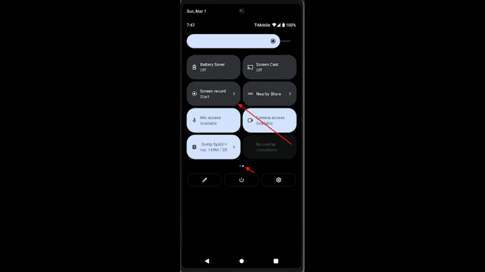

## android-platform-feature-06

### Title

Screen recording

### Description

The Android platform provides screen recording feature.

### Additional context

Screen recording is a feature that allow applications to capture the contents of the device’s display in real time.

### Demonstration

#### 01. Prepare the environment

Set up the required environment with:

* A physical Samsung A34 running Android 16 (api level 36)
* A physical Huawei P50 Pro running HarmonyOS 4.2.0 (Android API level 31)

#### 02. Open “Quick Settings”

Swipe down from the top of the AVD screen to open “Quick Settings”, then locate and tap “Screen record”. Note: Screen recording in the application does not require any manual setup through “Quick Settings”. The app can initiate screen recording programmatically, but it becomes active only after the user grants permission via the system prompt at runtime. The “Quick Settings” steps are shown here to demonstrate how screen recording works.

*Screenshot shows the screen recording control highlighted in Quick Settings.*

Because the Android platform provides screen recording feature, your app is at risk of:

- [android-platform-feature-06-risk-01](android-platform-feature-06-risk-01.md)
