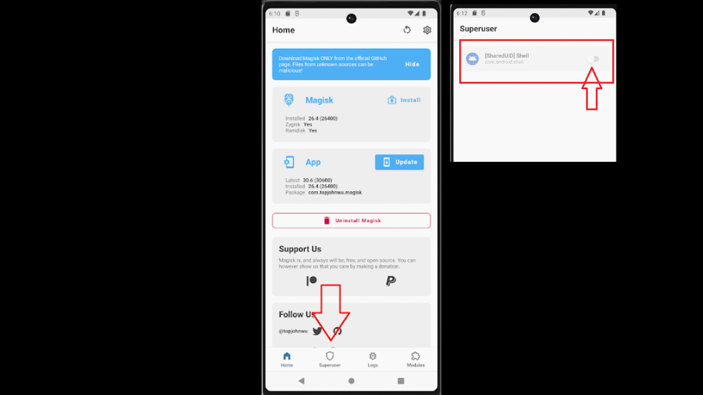

## android-platform-feature-07

### Title

Rooting

### Description

The Android platform provides rooting feature.

### Additional context

Rooting is a feature that gives full control over an Android device. It grants superuser access, allowing system files to be modified and Android restrictions to be bypassed via advanced tools that run with elevated privileges.

### Demonstration

#### 01. Prepare the environment

Set up the required environment with:

* An emulated Google Pixel 6 running Android 12 (api level 31)

#### 02. Download rootAVD

Download rootAVD on the host machine to obtain rootAVD.bat script used to root the AVD

```cmd
git clone https://gitlab.com/newbit/rootAVD.git
```

#### 03. Run rootAVD.bat

Run rootAVD.bat on the host machine, passing the path to ramdisk.img as an argument to modify the AVD’s boot image and install Magisk

```cmd
rootAVD.bat system-images\android-31\google_apis_playstore\x86_64\ramdisk.img
```

#### 04. Reboot the AVD and open Magisk

Reboot the AVD and open Magisk to confirm that root access has been enabled



*Screenshot shows the Magisk interface and a superuser permission prompt.*

Because the Android platform provides rooting feature, your app is at risk of:

- [android-platform-feature-07-risk-01](android-platform-feature-07-risk-01.md)
